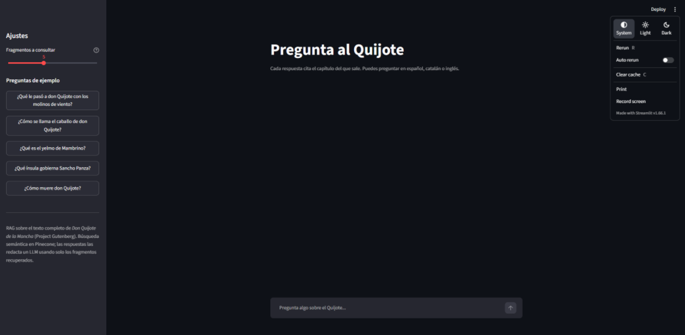
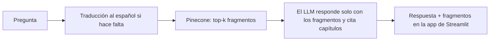

# RAG sobre «Don Quijote»

[Read in English](README.md)

Preguntas y respuestas sobre *Don Quijote de la Mancha* (texto en español, Project Gutenberg #2000). Haces una pregunta, el sistema recupera los pasajes más relevantes del libro y un LLM responde **usando solo esos pasajes**, citando el capítulo (por ejemplo `[Parte I, capítulo VIII]`). Si los pasajes recuperados no contienen la respuesta, lo dice en lugar de inventarla.

El proyecto incluye también un pequeño sistema de evaluación, porque lo interesante de un RAG es saber dónde falla. Los resultados de abajo incluyen los fallos.



## Cómo funciona



1. **Corpus** (`src/corpus.py`): carga el libro, quita la cabecera y el pie de Gutenberg y los preliminares, y lo divide en 126 capítulos (52 + 74) con metadatos: parte, número, título y una referencia para citar, como `Parte I, capítulo VIII`.
2. **Fragmentación** (`src/chunking.py`): fragmentos por frases de unos 1.000 caracteres, con un solapamiento de 200 caracteres que reutiliza frases enteras. Los fragmentos nunca cruzan capítulos, y las frases de más de 1.500 caracteres se parten por las comas. Resultado: 2.661 fragmentos, de 823 caracteres de media.
3. **Indexación** (`src/indexing.py`): sube los fragmentos a Pinecone con embeddings integrados (`llama-text-embed-v2`), índice `quijote-qa`, namespace `quijote-es`. Lotes de 96, con pausas para no pasar el límite de embeddings y reintentos solo ante errores 429/5xx o de red. Admite `--dry-run`.
4. **Recuperación** (`src/retrieval.py`): búsqueda semántica que devuelve los fragmentos con su puntuación, referencia de capítulo y título.
5. **Generación** (`src/llm.py`, `src/rag.py`): cualquier endpoint compatible con OpenAI (Groq en mi caso; Ollama también sirve). El prompt de sistema limita al modelo a los pasajes recuperados, le pide citar capítulos y responder en el idioma de la pregunta. Las preguntas en otros idiomas se traducen antes al español para la búsqueda (el modelo de embeddings maneja mal el catalán, ver resultados).
6. **App** (`app.py`): chat de Streamlit con preguntas de ejemplo, un control de `top_k` (3-8), los pasajes recuperados en un desplegable y la consulta realmente usada cuando hubo traducción.

## Tecnologías

Python 3.10+, Pinecone (embeddings integrados), una API de LLM compatible con OpenAI (Groq, `openai/gpt-oss-120b`), Streamlit, pytest. Las versiones están fijadas en `requirements.txt`.

## Estructura del proyecto

```
src/
  corpus.py        carga y limpieza del libro, división en capítulos
  chunking.py      fragmentación por frases con solapamiento
  indexing.py      embeddings y subida a Pinecone
  retrieval.py     búsqueda semántica
  llm.py           cliente del LLM, prompt, traducción de la consulta
  rag.py           ask(): traducir -> recuperar -> responder (también CLI)
app.py             app de chat en Streamlit
eval/
  questions.json         30 preguntas de evaluación con capítulos esperados
  check_questions.py     valida que los capítulos esperados existen
  run_eval.py            métricas de recuperación (hit@k, MRR)
  run_answers.py         métricas de respuestas (rechazo, cita, palabras clave)
  results_*.json         resultados guardados de las ejecuciones de abajo
tests/                   tests de pytest de carga del corpus y fragmentación
```

## Puesta en marcha

```bash
git clone <url-de-este-repo>
cd <este-repo>
python -m venv .venv
.venv\Scripts\Activate.ps1          # Windows PowerShell (macOS/Linux: source .venv/bin/activate)
python -m pip install -r requirements.txt
```

Crea un archivo `.env` a partir de `.env.example` y rellénalo con tus propias claves (está en `.gitignore`; no lo subas nunca):

| Variable | Significado |
|---|---|
| `PINECONE_API_KEY` | tu clave de Pinecone |
| `PINECONE_INDEX` | nombre del índice, `quijote-qa` en mi caso |
| `LLM_BASE_URL` | p. ej. `https://api.groq.com/openai/v1` |
| `LLM_API_KEY` | clave de ese proveedor de LLM |
| `LLM_MODEL` | p. ej. `openai/gpt-oss-120b` |

El libro **no** está en el repositorio. Descarga la edición en texto plano del ebook #2000 de Project Gutenberg y guárdala como `data/quijote.txt` (la carpeta `data/` está en `.gitignore`). Después:

```bash
python -m src.indexing --dry-run                         # revisa la fragmentación, sin llamadas a APIs
python -m src.indexing                                   # embeddings y subida (una sola vez)
python -m src.rag "¿Cómo se llama el caballo de don Quijote?"
python -m streamlit run app.py
```

Tests y evaluaciones:

```bash
python -m pytest -q
python -m eval.check_questions
python -m eval.run_eval
python -m eval.run_answers                  # opciones: --top-k 8, --ids q08 q15, --limit 3
```

## Evaluación

Construí un conjunto de 30 preguntas: 17 en español, 5 sobre temas que no están en el libro y 8 en catalán, inglés y ruso (3, 3 y 2). Cada pregunta con respuesta en el libro está etiquetada con el o los capítulos donde se responde, y `check_questions.py` comprueba que esos capítulos existen. **Las etiquetas son a nivel de capítulo y la muestra es pequeña**, así que los números son orientativos, no un benchmark.

### Recuperación

`hit@k`: algún fragmento de un capítulo esperado aparece entre los k primeros. `MRR`: media del inverso de la posición del primero de esos fragmentos. Para las preguntas que no están en español comparo la pregunta original con la versión traducida al español.

| Grupo | n | hit@3 | hit@5 | hit@8 | MRR |
|---|---|---|---|---|---|
| Español | 17 | 0,76 | 0,88 | 0,94 | 0,73 |
| Catalán, original | 3 | 0,33 | 0,33 | 0,33 | 0,33 |
| Catalán, traducida | 3 | 0,67 | 0,67 | 0,67 | 0,67 |
| Inglés, original | 3 | 1,00 | 1,00 | 1,00 | 0,78 |
| Inglés, traducida | 3 | 1,00 | 1,00 | 1,00 | 1,00 |
| Ruso, original | 2 | 0,50 | 0,50 | 0,50 | 0,50 |
| Ruso, traducida | 2 | 1,00 | 1,00 | 1,00 | 1,00 |

- En las 8 preguntas que no están en español, traducir la consulta sube el hit@3 de 5/8 a 7/8 y el MRR de unos 0,54 a 0,88. Con grupos de 2 o 3 preguntas es una pista, no una prueba.
- La única pregunta en español que no aparece entre los 8 primeros es la del cura y el barbero revisando la biblioteca de don Quijote. El mejor fragmento del capítulo correcto queda en el puesto 12. Reescribir la consulta con las palabras del propio libro («escrutinio», «librería») no ayudó.

### Respuestas

Ejecutado con `top_k=5`, temperatura 0 y `openai/gpt-oss-120b`. Métricas:

- **Rechazo en fuera de ámbito**: el modelo dice que la respuesta no está en los pasajes (5 preguntas sin relación con el libro).
- **Falsos rechazos**: rechaza una pregunta que sí tiene respuesta (sobre 25).
- **Capítulo esperado citado**: la respuesta cita alguno de los capítulos etiquetados (sobre 25).
- **Palabra clave**: aparece al menos una de las palabras clave esperadas (solo las 7 preguntas que tienen palabras clave).

| Configuración | Rechazo en fuera de ámbito | Falsos rechazos | Capítulo esperado citado | Palabra clave |
|---|---|---|---|---|
| Línea base (top_k=5) | 5/5 | 3/25 | 19/25 | 6/7 |
| top_k=8 | 5/5 | 4/25 | 18/25 | 6/7 |
| Título del capítulo añadido al contexto | 5/5 | 2/25 | 19/25 | 6/7 |

La ejecución con top_k=8 usó temperatura 0,2; la de top_k=5 con esa misma temperatura dio los mismos tres falsos rechazos que la línea base.

Los tres falsos rechazos de la línea base son la pelea con el vizcaíno (el modelo dice, con razón, que los fragmentos que recibió dejan la pelea sin terminar), la identidad del Caballero de la Blanca Luna y la penitencia en Sierra Morena.

### Experimentos que no salieron bien

- **Más contexto (`top_k` de 5 a 8)**: no mejora; un falso rechazo más y una cita correcta menos. Con una diferencia de una sola pregunta no sé si es el contexto extra o ruido, pero desde luego no es una mejora.
- **Un prompt de sistema más permisivo** («si los pasajes son parcialmente relevantes, responde con lo que dicen»): en la pregunta sobre la penitencia en Sierra Morena el modelo siguió rechazando, incluso dándole a mano solo los tres fragmentos relevantes. No ejecuté el conjunto completo con ese prompt, así que lo descarté sin evaluarlo más.
- **Añadir el título del capítulo al contexto**: la pregunta sobre Sierra Morena dejó de rechazarse, porque el título nombra el lugar y el texto del fragmento no. Pero la respuesta atribuye a don Quijote lo que el texto cuenta de Amadís (el retiro a la Peña Pobre y el nombre de Beltenebros). Efecto global en las 30 preguntas: un rechazo menos (ese), una respuesta que perdió su explicación y todo lo demás igual. No lo adopté.

Lo que saco de esto: el modelo es muy literal con los nombres propios que no están en el texto recuperado, y cuando la recuperación falla no siempre rechaza.

## Limitaciones

- **Muestra pequeña y etiquetas por capítulo.** Un fragmento del capítulo correcto cuenta como acierto aunque no contenga la respuesta. Las preguntas cuya respuesta aparece por todo el libro (el nombre de Rocinante) salen penalizadas en la métrica de cita aunque la respuesta sea correcta.
- **Las métricas automáticas no miden si la respuesta es correcta.** Detectan rechazos (con una lista de frases), citas y palabras clave. En la pregunta de la biblioteca del cura y el barbero, el modelo responde con seguridad sobre otra escena y ninguna métrica lo detecta. No revisé a mano las 25 respuestas respondibles, así que no doy un porcentaje de respuestas correctas.
- **Las preguntas fuera de ámbito son fáciles** (fútbol, paella, Harry Potter). Una prueba más dura serían preguntas sobre el libro cuya respuesta el libro no da.
- **Huecos de recuperación.** Algunas respuestas quedan justo fuera del top k, y el modelo de embeddings es flojo con el catalán, por eso las consultas se traducen antes.
- **El texto generado no es reproducible**, ni siquiera con temperatura 0: la redacción de una misma respuesta cambió entre ejecuciones, aunque los indicadores de rechazo y cita no.
- **Límites del plan gratuito.** En el plan gratuito de Groq, el modelo que uso tenía un tope diario de tokens (200.000 al día en mi cuenta cuando lo probé). Una pasada completa de la evaluación de respuestas cuesta, según mi estimación, unos 60-70K tokens, así que una demo pública necesita caché y un mensaje amable cuando se alcance el límite.

## Tests

19 tests de pytest cubren la carga del corpus (cabecera y pie de Gutenberg, preliminares, numeración de capítulos, números romanos, saltos de línea de Windows) y la fragmentación (ningún fragmento cruza capítulos, límite de tamaño, solapamiento, ninguna frase perdida, metadatos). Usan textos sintéticos pequeños, así que no necesitan claves de API. Un test comprueba el libro real (126 capítulos, 52 + 74) y se salta si no existe `data/quijote.txt`.

## Datos y licencia

El texto de *Don Quijote* procede de Project Gutenberg (#2000, dominio público) y no se redistribuye en este repositorio.