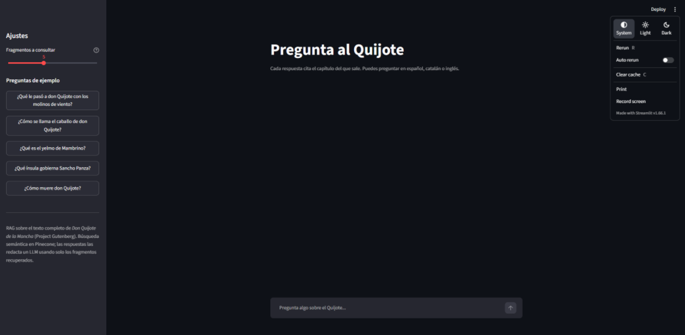

# Don Quixote RAG

[Leer en castellano](README.es.md)

Question answering over *Don Quixote* (Spanish text, Project Gutenberg #2000). You ask a question; the system retrieves the most relevant passages from the book, and an LLM answers **using only those passages**, citing the chapter (for example `[Parte I, capítulo VIII]`). If the retrieved passages do not contain the answer, it says so instead of making something up.

The project also includes a small evaluation harness, because the interesting part of a RAG system is knowing where it fails. The results below include the failures.

<!-- TODO: add a screenshot of the Streamlit app here, e.g.  -->

<!-- TODO: add the link to the online demo here once it exists -->

## How it works


1. **Corpus** (`src/corpus.py`): loads the book, strips the Gutenberg header/footer and the front matter, and splits it into 126 chapters (52 + 74) with metadata: part, number, title and a citation reference such as `Parte I, capítulo VIII`.
2. **Chunking** (`src/chunking.py`): sentence-based chunks of about 1,000 characters with a 200-character overlap that reuses whole sentences. Chunks never cross chapter boundaries, and sentences longer than 1,500 characters are split at commas. Result: 2,661 chunks, 823 characters on average.
3. **Indexing** (`src/indexing.py`): upserts the chunks into Pinecone with integrated embeddings (`llama-text-embed-v2`), index `quijote-qa`, namespace `quijote-es`. Batches of 96, throttled to stay under the embedding rate limit, retries only on 429/5xx/network errors. Supports `--dry-run`.
4. **Retrieval** (`src/retrieval.py`): semantic search that returns the chunks with score, chapter reference and title.
5. **Generation** (`src/llm.py`, `src/rag.py`): any OpenAI-compatible endpoint (Groq in my setup, Ollama also works). The system prompt restricts the model to the retrieved passages, asks for chapter citations and for the answer in the language of the question. Questions in other languages are first translated to Spanish for the search (the embedding model handles Catalan poorly, see results).
6. **App** (`app.py`): Streamlit chat with example questions, a `top_k` slider (3-8), the retrieved passages in an expander, and the search query actually used when a translation happened.

## Stack

Python 3.10+, Pinecone (integrated embeddings), an OpenAI-compatible LLM API (Groq, `openai/gpt-oss-120b`), Streamlit, pytest. Versions are pinned in `requirements.txt`.

## Project structure

```
src/
  corpus.py        load and clean the book, split into chapters
  chunking.py      sentence-based chunking with overlap
  indexing.py      embed and upsert into Pinecone
  retrieval.py     semantic search
  llm.py           LLM client, prompt, query translation
  rag.py           ask(): translate -> retrieve -> answer (also a CLI)
app.py             Streamlit chat app
eval/
  questions.json         30 evaluation questions with expected chapters
  check_questions.py     validates that the expected chapters exist
  run_eval.py            retrieval metrics (hit@k, MRR)
  run_answers.py         answer metrics (refusal, citation, keywords)
  results_*.json         saved results of the runs reported below
tests/                   pytest tests for corpus loading and chunking
```

## Quick start

```bash
git clone <this-repo-url>
cd <this-repo>
python -m venv .venv
.venv\Scripts\Activate.ps1          # Windows PowerShell (macOS/Linux: source .venv/bin/activate)
python -m pip install -r requirements.txt
```

Create a `.env` file from `.env.example` and fill in your own keys (it is git-ignored, never commit it):

| Variable | Meaning |
|---|---|
| `PINECONE_API_KEY` | your Pinecone key |
| `PINECONE_INDEX` | index name, `quijote-qa` in my setup |
| `LLM_BASE_URL` | e.g. `https://api.groq.com/openai/v1` |
| `LLM_API_KEY` | key for that LLM provider |
| `LLM_MODEL` | e.g. `openai/gpt-oss-120b` |

The book is **not** included in the repo. Download the plain-text edition of Project Gutenberg ebook #2000 and save it as `data/quijote.txt` (the `data/` folder is git-ignored). Then:

```bash
python -m src.indexing --dry-run                         # check the chunking, no API calls
python -m src.indexing                                   # embed and upload (run once)
python -m src.rag "¿Cómo se llama el caballo de don Quijote?"
python -m streamlit run app.py
```

Run the tests and the evaluations:

```bash
python -m pytest -q
python -m eval.check_questions
python -m eval.run_eval
python -m eval.run_answers                  # options: --top-k 8, --ids q08 q15, --limit 3
```

## Evaluation

I built a set of 30 questions: 17 in Spanish, 5 about topics that are not in the book, and 8 in Catalan, English and Russian (3, 3 and 2). Each answerable question is labelled with the chapter(s) where the answer is, and `check_questions.py` verifies that those chapters exist. **The labels are at chapter level and the sample is small**, so read the numbers as indicative, not as benchmarks.

### Retrieval

`hit@k`: a chunk from an expected chapter appears in the top k. `MRR`: mean reciprocal rank of the first such chunk. For non-Spanish questions I compare the original question with the version translated to Spanish.

| Group | n | hit@3 | hit@5 | hit@8 | MRR |
|---|---|---|---|---|---|
| Spanish | 17 | 0.76 | 0.88 | 0.94 | 0.73 |
| Catalan, original | 3 | 0.33 | 0.33 | 0.33 | 0.33 |
| Catalan, translated | 3 | 0.67 | 0.67 | 0.67 | 0.67 |
| English, original | 3 | 1.00 | 1.00 | 1.00 | 0.78 |
| English, translated | 3 | 1.00 | 1.00 | 1.00 | 1.00 |
| Russian, original | 2 | 0.50 | 0.50 | 0.50 | 0.50 |
| Russian, translated | 2 | 1.00 | 1.00 | 1.00 | 1.00 |

- Across the 8 non-Spanish questions, translating the query raises hit@3 from 5/8 to 7/8 and MRR from about 0.54 to 0.88. With groups of 2 or 3 questions this is a hint, not a proof.
- The one Spanish question missed in the top 8 is about the priest and the barber going through Don Quixote's library. The best chunk from the right chapter ranks 12th. Rewriting the query with the book's own words ("escrutinio", "librería") did not help.

### Answers

Run with `top_k=5`, temperature 0 and `openai/gpt-oss-120b`. Metrics:

- **Refusal on out-of-scope**: the model says the answer is not in the passages (5 questions unrelated to the book).
- **False refusals**: it refuses on an answerable question (out of 25).
- **Expected chapter cited**: the answer cites one of the labelled chapters (out of 25).
- **Keyword**: at least one expected keyword appears (only the 7 questions that have keywords).

| Configuration | Refusal on out-of-scope | False refusals | Expected chapter cited | Keyword |
|---|---|---|---|---|
| Baseline (top_k=5) | 5/5 | 3/25 | 19/25 | 6/7 |
| top_k=8 | 5/5 | 4/25 | 18/25 | 6/7 |
| Chapter title added to the prompt context | 5/5 | 2/25 | 19/25 | 6/7 |

The top_k=8 run used temperature 0.2; the top_k=5 run at that same temperature produced the same three false refusals as the baseline.

The three false refusals in the baseline are the vizcaíno fight (the model correctly says the fragments it received leave the fight unfinished), the identity of the White Moon knight, and the penance in Sierra Morena.

### Experiments that did not pan out

- **More context (`top_k` 5 → 8)**: no improvement; one more false refusal and one fewer correct citation. With a difference of one question I cannot tell whether that is the extra context or noise, but it is certainly not an improvement.
- **A more permissive system prompt** ("if the passages are partially relevant, answer with what they say"): on the question about the penance in Sierra Morena the model kept refusing, even when I gave it only the three relevant chunks by hand. I did not run the full set with this prompt, so I discarded it without further evaluation.
- **Adding the chapter title to the context**: the question about Sierra Morena stopped being refused, because the title names the place and the chunk text did not. But the answer attributes to Don Quixote what the text says about Amadís (the retreat to the Peña Pobre and the name Beltenebros). Overall effect on the 30 questions: one fewer refusal (that one), one answer that lost its explanation, everything else unchanged. Not adopted.

What I take from this: the model is very literal with proper nouns that are not in the retrieved text, and when retrieval fails it does not always refuse.

## Limitations

- **Small sample, chapter-level labels.** A chunk from the right chapter counts as a hit even if it does not contain the answer. Questions where the answer appears all over the book (the name of Rocinante) are penalised by the citation metric even when the answer is correct.
- **The automatic metrics do not measure correctness.** They detect refusals (by a list of phrases), citations and keywords. For the question about the priest and the barber's library, the model answers with confidence about a different scene, and no metric flags it. I did not manually review the 25 answerable answers, so I do not report a percentage of correct answers.
- **The out-of-scope questions are easy** (football, paella, Harry Potter). A harder test would be questions about the book whose answer the book does not give.
- **Retrieval gaps.** Some answers sit just outside the top k, and the embedding model is weak with Catalan, which is why queries are translated first.
- **The generated text is not reproducible**, even at temperature 0: the wording of the same answer changed between runs, although the refusal and citation flags did not.
- **Free-tier limits.** On Groq's free tier the model I use had a daily token cap (200,000 tokens per day on my account when I tested). One full pass of the answer evaluation costs roughly 60-70K tokens by my estimate, so a public demo needs caching and a friendly message when the limit is hit.

## Tests

19 pytest tests cover corpus loading (Gutenberg header/footer, front matter, chapter numbering, Roman numerals, Windows line endings) and chunking (no chunk crosses chapters, size limit, overlap, no sentence lost, metadata). They use small synthetic texts, so they need no API keys. One test checks the real book (126 chapters, 52 + 74) and is skipped when `data/quijote.txt` is not present.

## Data and licence

The text of *Don Quixote* comes from Project Gutenberg (#2000, public domain) and is not redistributed in this repository.